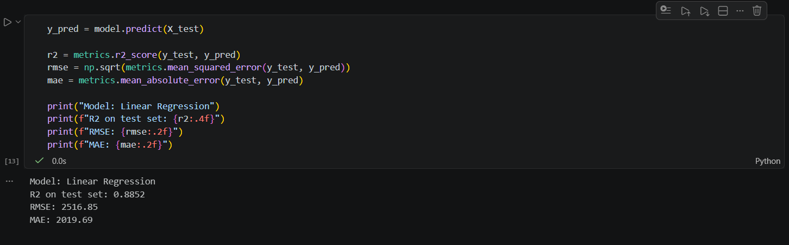

# Insurance-Cost-Prediction

Predicts annual medical insurance cost from patient demographics, lifestyle and health factors using linear regression (pandas, matplotlib, scikit-learn) in a Jupyter notebook.

 

**Course:** AI101: Data Science and AI Essentials with Python, School of AI and Data Engineering, IIT Ropar
**Team no.:** 32

## Team and roles

| Member | Entry no. | GitHub handle | Role |
|---|---|---|---|
| Rakshith A Y | 2026DAB1303 | Rakshith-1303 | Video Lead |
| Nikhil Meena | 2026MCB1549 | Nikhil-1805 | Execution Lead |
| Harsh Raj | 2026AIB1041 | Harsh-IIT-Ropar | Documentation Lead |
| Prem Kiran Gedala | 2026EEB1394 | 2026eeb1394-boop | PPT Lead |

*All four members contributed code (see commit history).*

## Problem and dataset

- **Problem:** Medical Insurance Cost Prediction: estimate how much a customer's medical care costs in a year, so that insurers can price premiums and people can see which factors raise costs.
- **Task:** Linear regression with `annual_medical_cost_usd` as the target
- **Dataset:** Healthcare Insurance Cost Prediction Dataset (Kaggle, by miadul): https://www.kaggle.com/datasets/miadul/healthcare-insurance-cost-prediction-dataset
- **File used:** `data/medical_insurance_cost_dataset_enhanced.csv`
- **Size:** 7,500 rows, 22 columns (no missing values)
- **Columns:**
  - Identifier: `customer_id`
  - Demographics: `age`, `gender`, `children`, `marital_status`, `region`, `occupation`, `annual_income_usd`
  - Lifestyle: `smoker`, `exercise_level`, `alcohol_consumption_per_week`, `sleep_hours`, `stress_level`
  - Health: `bmi`, `blood_pressure`, `cholesterol`, `diabetes`, `chronic_diseases`
  - Healthcare use: `doctor_visits_per_year`, `hospitalizations_last_year`
  - Insurance and cost: `insurance_plan`, `annual_medical_cost_usd`

## Approach

The notebook `src/main.ipynb` runs these steps, one cell at a time:

1. Import libraries and load the dataset
2. Check the data (shape, missing values, duplicates, summary of the cost column)
3. Explore: cost distribution and correlation heatmap
4. Prepare: drop `customer_id`, split `blood_pressure` into systolic and diastolic values, one-hot encode the text columns, split 80% train and 20% test (`random_state=42`)
5. Train a linear regression model
6. Evaluate with R², RMSE and MAE, and draw predicted vs actual and residual charts
7. Show the features with the largest coefficients
8. Save actual vs predicted cost for the test set to `outputs/predictions.csv`

## Project structure

```
insurance-cost-prediction/
├── data/
│   └── medical_insurance_cost_dataset_enhanced.csv
├── src/
│   └── main.ipynb
├── outputs/
│   ├── target_distribution.png
│   ├── correlation_heatmap.png
│   ├── predicted_vs_actual.png
│   ├── residuals.png
│   ├── coefficients.png
│   └── predictions.csv
├── docs/
│   ├── expected_output.png
│   └── Medical_Insurance_Presentation 
├── requirements.txt
├── .gitignore
└── README.md
```

## Setup

Tested on Python 3.14.6 (Windows).

```bash
git clone https://github.com/Harsh-IIT-Ropar/insurance-cost-prediction.git
cd insurance-cost-prediction
python -m venv venv
venv\Scripts\activate          #Mac/Linux  source venv/bin/activate     
pip install -r requirements.txt
```

Library versions are pinned in `requirements.txt`.

## How to run

1. In the repo folder (with the virtual environment active), run `jupyter notebook`
2. In the browser page that opens, open `src/main.ipynb`
3. Click **Run → Run All Cells**
4. The notebook prints the metrics under each cell and saves the charts and `predictions.csv` in `outputs/`
5. Expected runtime: about 5 to 20 seconds for Run All Cells (the first run is slower while the libraries load)

## Expected output

After Run All Cells, the evaluation cell should print:



Files saved in `outputs/`:
- `target_distribution.png`
- `correlation_heatmap.png`
- `predicted_vs_actual.png`
- `residuals.png`
- `coefficients.png`
- `predictions.csv` (actual vs predicted cost for the 1,500 test customers)

## Results

| Metric | Value |
|---|---|
| R² (test set) | 0.8852 |
| RMSE | 2516.85 |
| MAE | 2019.69 |

- The model explains about 88.5% of the variation in annual medical cost on the test set, with a typical error of about $2,000 to $2,500.
- Smoking status had the largest effect: holding other factors equal, smokers had a predicted cost about $13,900 higher than non-smokers.
- Chronic diseases, hospitalizations, the Gold insurance plan and low exercise level were the next strongest factors, while region and occupation had little effect.

## Links

- Slides (5 slides): [Medical_Insurance_Presentation.pptx](<Medical_Insurance_Presentation (1).pptx>)
- Video (max 5 min): [TODO: unlisted YouTube or Drive link]

## AI-use disclosure

- Claude (Anthropic): used by us for Learning purpose ,Guidance in Set-up Git-Hub, and Giving intial Structure of Readme .
- It also helps to solve doubts, debug the code and removing error.
- No AI was used to generate the dataset or the results.
